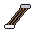
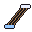
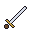
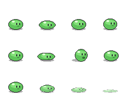
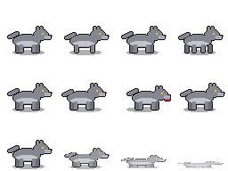
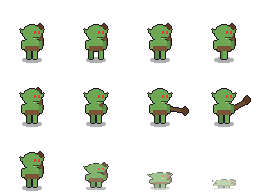
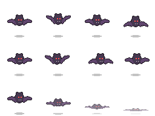
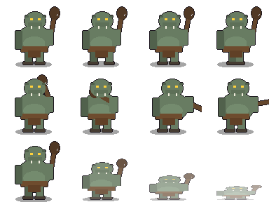

# Tuning catalog（遊戲數值總表）

> **Generated by `npm run tuning`. Don't edit this file**: edit the CSV sheets in this folder
> (see [README.md](README.md)), then run `npm run tuning` again.
> Art: click a file link to open it; how to make replacements is in [ASSETS.md](../assets/ASSETS.md).

Contents: [Items](#items) · [Equipment](#equipment) · [Monsters](#monsters) · [Encounter rates](#encounter-rates) · [Exp table](#exp-table)

## Items

Sheet: [items.csv](items.csv). Sell price = buy price × 0.5. Potions in the same cooldown group share one cooldown.

| Icon | Item | Effect | Cooldown | Classes | Weight | Buy / Sell | Sold by | Icon file |
|---|---|---|---|---|---|---|---|---|
|  | 金幣 `gold` | — | — | 全部 | 0 | 1 / 0 | — | [gold.png](../assets/sprites/icons/gold.png) |
|  | 紅色藥水 `potion_hp_s` | HP +15 | 1.5 s (hp) | 全部 | 5 | 15 / 7 | 雜貨商 葛倫 | [potion_red.png](../assets/sprites/icons/potion_red.png) |
|  | 濃縮紅色藥水 `potion_hp_l` | HP +45 | 4 s (hp) | 全部 | 8 | 60 / 30 | 雜貨商 葛倫 | [potion_orange.png](../assets/sprites/icons/potion_orange.png) |
|  | 藍色藥水 `potion_mp` | MP +12 | 4 s (mp) | 全部 | 5 | 30 / 15 | 雜貨商 葛倫 | [potion_blue.png](../assets/sprites/icons/potion_blue.png) |
|  | 猛攻藥劑 `potion_rage` | 最大傷害 30 s | 60 s (maxDamage) | 騎士 | 5 | 100 / 50 | 雜貨商 葛倫 | [potion_purple.png](../assets/sprites/icons/potion_purple.png) |
|  | 箭 `arrow` | 箭傷害 +1 | — | 全部 | 0.2 | 1 / 0 | 雜貨商 葛倫 | [arrows.png](../assets/sprites/icons/arrows.png) |
|  | 銀箭 `arrow_silver` | 箭傷害 +3 | — | 全部 | 0.2 | 4 / 2 | 雜貨商 葛倫 | [arrows_silver.png](../assets/sprites/icons/arrows_silver.png) |
|  | 回家卷軸 `scroll_return` | 回到村莊 | 2 s (scroll) | 全部 | 2 | 30 / 15 | 雜貨商 葛倫 | [scroll_return.png](../assets/sprites/icons/scroll_return.png) |
|  | 瞬間移動卷軸 `scroll_teleport` | 隨機傳送 | 2 s (scroll) | 全部 | 2 | 40 / 20 | 雜貨商 葛倫 | [scroll_teleport.png](../assets/sprites/icons/scroll_teleport.png) |
|  | 記錄卷軸 `scroll_save` | 記錄進度 | 2 s (scroll) | 全部 | 2 | 10 / 5 | 雜貨商 葛倫 | [scroll_save.png](../assets/sprites/icons/scroll_save.png) |

## Equipment

Sheet: [equipment.csv](equipment.csv). "Safe +" is the enhancement level that always succeeds
(hidden from players). Damage is before the player's STR/DEX bonus, arrows and the target's Def.

| Icon | Item | Slot | Classes | Lv | Attack | Def / MR | Durability | Safe + | Weight | Buy / Sell | Files |
|---|---|---|---|---|---|---|---|---|---|---|---|
|  | 練習用長劍 `sword_practice` | 武器 | 騎士 | 1 | 3–7, hit 85%, 0.8 s (slash) | 0 / 0% | 300 | +6 | 100 | 100 / 50 | [sword.png](../assets/sprites/icons/sword.png) [sword_short.png](../assets/sprites/characters/sword_short.png) |
|  | 鐵製長劍 `sword_iron` | 武器 | 騎士 | 5 | 5–10, hit 85%, 0.8 s (slash) | 0 / 0% | 400 | +6 | 120 | 600 / 300 | [sword.png](../assets/sprites/icons/sword.png) [sword_long.png](../assets/sprites/characters/sword_long.png) |
|  | 獵人短弓 `bow_short` | 武器 | 妖精 | 1 | 1–5, hit 90%, 0.9 s, range 6, 2-handed (shoot) | 0 / 0% | 300 | +6 | 60 | 100 / 50 | [bow.png](../assets/sprites/icons/bow.png) [bow_short.png](../assets/sprites/characters/bow_short.png) |
|  | 學徒法杖 `staff_apprentice` | 武器 | 法師 | 1 | 1–4, hit 75%, 0.9 s, 2-handed (thrust) | 0 / 0% | 300 | +6 | 80 | 100 / 50 | [staff.png](../assets/sprites/icons/staff.png) [staff_wood.png](../assets/sprites/characters/staff_wood.png) |
|  | 皮甲 `armor_leather` | 盔甲 | 騎士、妖精 | 1 | — | 2 / 0% | — | +4 | 120 | 80 / 40 | [armor_leather.png](../assets/sprites/icons/armor_leather.png) [armor_leather.png](../assets/sprites/characters/armor_leather.png) |
|  | 布袍 `robe_cloth` | 盔甲 | 全部 | 1 | — | 1 / 5% | — | +4 | 40 | 60 / 30 | [cloak.png](../assets/sprites/icons/cloak.png) [robe_purple.png](../assets/sprites/characters/robe_purple.png) |
|  | 木盾 `shield_wood` | 盾牌 | 騎士 | 1 | — | 1 / 0% | — | +4 | 80 | 60 / 30 | [shield.png](../assets/sprites/icons/shield.png) [shield_wood.png](../assets/sprites/characters/shield_wood.png) |
|  | 鎖子甲 `armor_chain` | 盔甲 | 騎士 | 1 | — | 3 / 0% | — | +4 | 150 | 200 / 100 | [armor_leather.png](../assets/sprites/icons/armor_leather.png) [armor_chain.png](../assets/sprites/characters/armor_chain.png) |
|  | 鐵頭盔 `helmet_iron` | 頭盔 | 騎士 | 1 | — | 1 / 0% | — | +4 | 40 | 120 / 60 | [helmet.png](../assets/sprites/icons/helmet.png) [helmet_iron.png](../assets/sprites/characters/helmet_iron.png) |
|  | 法師帽 `hat_wizard` | 頭盔 | 法師 | 1 | — | 0 / 5% | — | +4 | 10 | 60 / 30 | [helmet.png](../assets/sprites/icons/helmet.png) [hat_wizard.png](../assets/sprites/characters/hat_wizard.png) |
|  | 皮帽 `helmet_leather` | 頭盔 | 全部 | 1 | — | 1 / 0% | — | +4 | 30 | 50 / 25 | [helmet.png](../assets/sprites/icons/helmet.png) [helmet_leather.png](../assets/sprites/characters/helmet_leather.png) |
|  | 皮靴 `boots_leather` | 靴子 | 全部 | 1 | — | 1 / 0% | — | +4 | 30 | 50 / 25 | [boots.png](../assets/sprites/icons/boots.png) [boots_leather.png](../assets/sprites/characters/boots_leather.png) |
|  | 皮手套 `gloves_leather` | 手套 | 全部 | 3 | — | 1 / 0% | — | +4 | 20 | 50 / 25 | [gloves.png](../assets/sprites/icons/gloves.png) [gloves_leather.png](../assets/sprites/characters/gloves_leather.png) |

## Monsters

Sheets: [monsters.csv](monsters.csv), [drops.csv](drops.csv), [spawns.csv](spawns.csv). Where a
monster lives and how many there are is set per spawn area (see [Encounter rates](#encounter-rates)).

| Monster | Lv | HP | Attack | Hit / Evasion | Def / MR | Behaviour | Exp | Align | Found in |
|---|---|---|---|---|---|---|---|---|---|
| [草原黏菌](#slime) | 1 | 14 | 1–3 / 1.2 s | 60% / 0% | 0 / 0% | passive | 6 | 0 | 東郊草原 |
| [灰牙狼](#wolf) | 3 | 30 | 2–5 / 1 s | 70% / 5% | 2 / 0% | aggressive (5 tiles) | 14 | 0 | 東郊草原 |
| [綠皮小鬼](#imp) | 5 | 50 | 3–8 / 1.1 s | 75% / 10% | 5 / 10% | aggressive (6 tiles) | 30 | -40 | 東郊草原 |
| [洞窟蝙蝠](#bat) | 6 | 32 | 3–7 / 0.8 s | 80% / 25% | 0 / 0% | aggressive (6 tiles) | 40 | -10 | 暗影洞窟 |
| [骷髏戰士](#skeleton) | 8 | 90 | 5–11 / 1.2 s | 80% / 5% | 12 / 20% | aggressive (5 tiles) | 80 | -60 | 暗影洞窟 |
| [岩窟巨魔](#troll) 👑 | 15 | 1200 | 8–18 / 1.6 s | 85% / 5% | 15 / 25% | aggressive (8 tiles) | 3000 | -200 | 暗影洞窟 |

### 草原黏菌 `slime` 

 Sprite: [slime.png](../assets/sprites/monsters/slime.png)

| Lv | HP | Attack | Hit / Evasion | Def / MR | Move | Leash | Exp | Alignment |
|---|---|---|---|---|---|---|---|---|
| 1 | 14 | 1–3 every 1.2 s | 60% / 0% | 0 / 0% | 0.5 s per tile | 10 tiles | 6 | 0 |

**Found in**
- 東郊草原 (area `slimesNorth`): up to **6** at a time, respawn **20 s**, 1 per 37 tiles; ≤ 1080 kills/hour if every one dies at once
- 東郊草原 (area `slimesSouth`): up to **6** at a time, respawn **20 s**, 1 per 37 tiles; ≤ 1080 kills/hour if every one dies at once

**Drops**
- 金幣 2–6 (always)
- 紅色藥水 ×1: **15%** (≈ 15 per 100 kills)

### 灰牙狼 `wolf` 

 Sprite: [wolf.png](../assets/sprites/monsters/wolf.png)

| Lv | HP | Attack | Hit / Evasion | Def / MR | Move | Leash | Exp | Alignment |
|---|---|---|---|---|---|---|---|---|
| 3 | 30 | 2–5 every 1 s | 70% / 5% | 2 / 0% | 0.3 s per tile | 12 tiles | 14 | 0 |

**Found in**
- 東郊草原 (area `wolves`): up to **5** at a time, respawn **40 s**, 1 per 106 tiles; ≤ 450 kills/hour if every one dies at once

**Drops**
- 金幣 5–12 (always)
- 紅色藥水 ×1: **20%** (≈ 20 per 100 kills)
- 皮靴 ×1: **3%** (≈ 3 per 100 kills)
- 箭 ×5–15: **20%** (≈ 20 per 100 kills)

### 綠皮小鬼 `imp` 

 Sprite: [imp.png](../assets/sprites/monsters/imp.png)

| Lv | HP | Attack | Hit / Evasion | Def / MR | Move | Leash | Exp | Alignment |
|---|---|---|---|---|---|---|---|---|
| 5 | 50 | 3–8 every 1.1 s | 75% / 10% | 5 / 10% | 0.4 s per tile | 12 tiles | 30 | -40 |

**Found in**
- 東郊草原 (area `imps`): up to **6** at a time, respawn **1 min**, 1 per 76 tiles; ≤ 360 kills/hour if every one dies at once

**Drops**
- 金幣 10–25 (always)
- 紅色藥水 ×1: **25%** (≈ 25 per 100 kills)
- 藍色藥水 ×1: **10%** (≈ 10 per 100 kills)
- 皮帽 ×1: **4%** (≈ 4 per 100 kills)
- 皮手套 ×1: **4%** (≈ 4 per 100 kills)
- 鐵製長劍 ×1: **2%** (≈ 2 per 100 kills)
- 回家卷軸 ×1: **5%** (≈ 5 per 100 kills)
- 瞬間移動卷軸 ×1: **5%** (≈ 5 per 100 kills)
- 銀箭 ×5–12: **10%** (≈ 10 per 100 kills)

### 洞窟蝙蝠 `bat` 

 Sprite: [bat.png](../assets/sprites/monsters/bat.png)

| Lv | HP | Attack | Hit / Evasion | Def / MR | Move | Leash | Exp | Alignment |
|---|---|---|---|---|---|---|---|---|
| 6 | 32 | 3–7 every 0.8 s | 80% / 25% | 0 / 0% | 0.2 s per tile | 10 tiles | 40 | -10 |

**Found in**
- 暗影洞窟 (area `bats`): up to **7** at a time, respawn **30 s**, 1 per 20 tiles; ≤ 840 kills/hour if every one dies at once

**Drops**
- 金幣 5–15 (always)
- 紅色藥水 ×1: **20%** (≈ 20 per 100 kills)
- 藍色藥水 ×1: **8%** (≈ 8 per 100 kills)

### 骷髏戰士 `skeleton` 

 Sprite: [skeleton.png](../assets/sprites/monsters/skeleton.png)

| Lv | HP | Attack | Hit / Evasion | Def / MR | Move | Leash | Exp | Alignment |
|---|---|---|---|---|---|---|---|---|
| 8 | 90 | 5–11 every 1.2 s | 80% / 5% | 12 / 20% | 0.5 s per tile | 10 tiles | 80 | -60 |

**Found in**
- 暗影洞窟 (area `skeletons`): up to **6** at a time, respawn **45 s**, 1 per 26 tiles; ≤ 480 kills/hour if every one dies at once

**Drops**
- 金幣 20–45 (always)
- 濃縮紅色藥水 ×1: **10%** (≈ 10 per 100 kills)
- 銀箭 ×5–15: **15%** (≈ 15 per 100 kills)
- 鐵製長劍 ×1: **3%** (≈ 3 per 100 kills)
- 回家卷軸 ×1: **8%** (≈ 8 per 100 kills)

### 岩窟巨魔 `troll` 👑 boss 

 Sprite: [troll.png](../assets/sprites/monsters/troll.png)

| Lv | HP | Attack | Hit / Evasion | Def / MR | Move | Leash | Exp | Alignment |
|---|---|---|---|---|---|---|---|---|
| 15 | 1200 | 8–18 every 1.6 s | 85% / 5% | 15 / 25% | 0.4 s per tile | 30 tiles | 3000 | -200 |

**Found in**
- 暗影洞窟 (area `boss`): up to **1** at a time, respawn **1 h–2 h**, 1 per 480 tiles; boss: appears again 1 h–2 h of play time after it dies

**Drops**
- 金幣 300–800 (always)
- 濃縮紅色藥水 ×3–6: **100%** (≈ 100 per 100 kills)
- 銀箭 ×30–60: **60%** (≈ 60 per 100 kills)
- 鐵製長劍 ×1: **40%** (≈ 40 per 100 kills)
- 皮手套 ×1: **30%** (≈ 30 per 100 kills)
- 皮帽 ×1: **30%** (≈ 30 per 100 kills)
- 瞬間移動卷軸 ×1–3: **50%** (≈ 50 per 100 kills)

## Encounter rates

How often a player meets each monster, per spawn area. "Max kills/hour" assumes every monster
dies the moment it appears, so real numbers are lower; it shows how much a spot can give.
Areas are drawn in Tiled; the numbers come from [spawns.csv](spawns.csv).

| Map | Area | Monster | Max alive | Respawn | Area size | Density | Max kills/h | Max Exp/h |
|---|---|---|---|---|---|---|---|---|
| 暗影洞窟 | `bats` | 洞窟蝙蝠 | 7 | 30 s | 143 tiles | 1 per 20 tiles | 840 | 33600 |
| 暗影洞窟 | `skeletons` | 骷髏戰士 | 6 | 45 s | 154 tiles | 1 per 26 tiles | 480 | 38400 |
| 暗影洞窟 | `boss` | 岩窟巨魔 | 1 | 1 h–2 h | 480 tiles | 1 per 480 tiles | ≈ 0.67 | 2000 |
| 東郊草原 | `slimesNorth` | 草原黏菌 | 6 | 20 s | 224 tiles | 1 per 37 tiles | 1080 | 6480 |
| 東郊草原 | `slimesSouth` | 草原黏菌 | 6 | 20 s | 224 tiles | 1 per 37 tiles | 1080 | 6480 |
| 東郊草原 | `wolves` | 灰牙狼 | 5 | 40 s | 532 tiles | 1 per 106 tiles | 450 | 6300 |
| 東郊草原 | `imps` | 綠皮小鬼 | 6 | 1 min | 456 tiles | 1 per 76 tiles | 360 | 10800 |

## Exp table

Sheet: [exp.csv](exp.csv). Death costs 10% of the current level's span (never
below level 10). The kill columns show how many of each monster one level takes.

| Lv | Exp to next | Total Exp | Death loss | 草原黏菌 (6) | 灰牙狼 (14) | 綠皮小鬼 (30) | 洞窟蝙蝠 (40) | 骷髏戰士 (80) |
|---|---|---|---|---|---|---|---|---|
| 1 | 50 | 50 | 5 | 9 | 4 | 2 | 2 | 1 |
| 2 | 75 | 125 | 7 | 13 | 6 | 3 | 2 | 1 |
| 3 | 113 | 238 | 11 | 19 | 9 | 4 | 3 | 2 |
| 4 | 169 | 407 | 16 | 29 | 13 | 6 | 5 | 3 |
| 5 | 253 | 660 | 25 | 43 | 19 | 9 | 7 | 4 |
| 6 | 380 | 1,040 | 38 | 64 | 28 | 13 | 10 | 5 |
| 7 | 570 | 1,610 | 57 | 95 | 41 | 19 | 15 | 8 |
| 8 | 854 | 2,464 | 85 | 143 | 61 | 29 | 22 | 11 |
| 9 | 1,281 | 3,745 | 128 | 214 | 92 | 43 | 33 | 17 |
| 10 | 1,922 | 5,667 | 192 | 321 | 138 | 65 | 49 | 25 |
| 11 | 2,883 | 8,550 | 288 | 481 | 206 | 97 | 73 | 37 |
| 12 | 4,325 | 12,875 | 432 | 721 | 309 | 145 | 109 | 55 |
| 13 | 6,487 | 19,362 | 648 | 1,082 | 464 | 217 | 163 | 82 |
| 14 | 9,731 | 29,093 | 973 | 1,622 | 696 | 325 | 244 | 122 |
| 15 | 14,596 | 43,689 | 1,459 | 2,433 | 1,043 | 487 | 365 | 183 |
| 16 | 21,895 | 65,584 | 2,189 | 3,650 | 1,564 | 730 | 548 | 274 |
| 17 | 32,842 | 98,426 | 3,284 | 5,474 | 2,346 | 1,095 | 822 | 411 |
| 18 | 49,263 | 147,689 | 4,926 | 8,211 | 3,519 | 1,643 | 1,232 | 616 |
| 19 | 73,895 | 221,584 | 7,389 | 12,316 | 5,279 | 2,464 | 1,848 | 924 |
| 20 | 110,842 | 332,426 | 11,084 | 18,474 | 7,918 | 3,695 | 2,772 | 1,386 |
| 21 | 166,263 | 498,689 | 16,626 | 27,711 | 11,876 | 5,543 | 4,157 | 2,079 |
| 22 | 249,394 | 748,083 | 24,939 | 41,566 | 17,814 | 8,314 | 6,235 | 3,118 |
| 23 | 374,091 | 1,122,174 | 37,409 | 62,349 | 26,721 | 12,470 | 9,353 | 4,677 |
| 24 | 561,137 | 1,683,311 | 56,113 | 93,523 | 40,082 | 18,705 | 14,029 | 7,015 |
| 25 | 841,706 | 2,525,017 | 84,170 | 140,285 | 60,122 | 28,057 | 21,043 | 10,522 |
| 26 | 1,262,558 | 3,787,575 | 126,255 | 210,427 | 90,183 | 42,086 | 31,564 | 15,782 |
| 27 | 1,893,838 | 5,681,413 | 189,383 | 315,640 | 135,275 | 63,128 | 47,346 | 23,673 |
| 28 | 2,840,756 | 8,522,169 | 284,075 | 473,460 | 202,912 | 94,692 | 71,019 | 35,510 |
| 29 | 4,261,135 | 12,783,304 | 426,113 | 710,190 | 304,367 | 142,038 | 106,529 | 53,265 |
